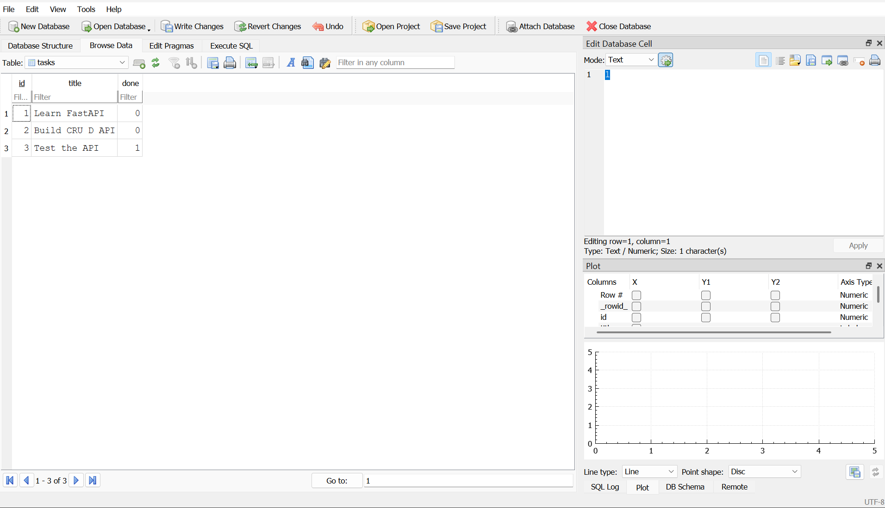

# Task API

A REST API built with Python and FastAPI for managing a to-do list.

The project demonstrates the four basic CRUD operations:

- **Create** tasks
- **Read** tasks
- **Update** tasks
- **Delete** tasks

Tasks are stored in an SQLite database, so they remain saved when the server is restarted.

---

## Technologies Used

- Python 3
- FastAPI
- SQLite
- PostgreSQL
- Docker
- Uvicorn
- Pydantic
- Swagger UI
- Git & GitHub

---

## Getting Started

### 1. Install the Dependencies

After cloning the repository, install the required packages:

```bash
pip install -r requirements.txt
```

### 2. Start the API

Run the following command:

```bash
uvicorn main:app --reload
```

The server will start at:

`http://localhost:8000`

The database file (`tasks.db`) and its table are created automatically when the application starts.

### 3. Open the API

- **Main API:** http://localhost:8000
- **Health Check:** http://localhost:8000/health
- **Swagger Documentation:** http://localhost:8000/docs

---

## API Endpoints

| Method | Endpoint | Description |
|:---:|---|---|
| GET | `/` | Displays API information |
| GET | `/health` | Checks whether the API is running |
| GET | `/tasks` | Returns all tasks |
| GET | `/tasks/{id}` | Returns a single task |
| POST | `/tasks` | Creates a new task |
| PUT | `/tasks/{id}` | Updates an existing task |
| DELETE | `/tasks/{id}` | Deletes a task |

---

## Task Format

Each task contains three fields:

```json
{
  "id": 1,
  "title": "Learn FastAPI",
  "done": false
}
```

- `id` — unique task number
- `title` — task description
- `done` — indicates whether the task has been completed

---

## CRUD Operations

### Create a Task

A new task can be created using `POST /tasks`.

Example request:

```bash
curl -i -X POST http://localhost:8000/tasks -H "Content-Type: application/json" -d "{\"title\":\"Buy milk\"}"
```

A successful request returns `201 Created` with the new task.

### Read Tasks

To retrieve all tasks:

```bash
curl http://localhost:8000/tasks
```

To retrieve a specific task:

```bash
curl http://localhost:8000/tasks/1
```

### Update a Task

For example, to mark task 1 as completed:

```bash
curl -i -X PUT http://localhost:8000/tasks/1 -H "Content-Type: application/json" -d "{\"done\":true}"
```

The API returns the updated task with a `200 OK` response.

### Delete a Task

To delete task 1:

```bash
curl -i -X DELETE http://localhost:8000/tasks/1
```

A successful deletion returns `204 No Content`.

---

## Database

SQLite was chosen because it is lightweight, easy to use, and does not require a separate database server.

The database is stored in a file named `tasks.db` in the project directory. The application automatically creates the database and the `tasks` table if they do not exist. It also inserts the initial tasks when the table is empty.

### Example SQL Query

The following query retrieves all completed tasks:

```sql
SELECT * FROM tasks WHERE done = 1;
```

In the database, `1` represents a completed task and `0` represents an incomplete task.

### Database Screenshot



---

## Error Handling

The API returns appropriate HTTP status codes when requests succeed or fail.

| Status Code | Meaning | Example |
|:---:|---|---|
| `200` | Request successful | Reading or updating a task |
| `201` | Resource created | Creating a task |
| `204` | Successful deletion | Deleting a task |
| `400` | Invalid request | Empty update body |
| `404` | Task not found | Requesting `/tasks/99` |

---

## Project Structure

```text
task-api/
│
├── main.py
├── requirements.txt
├── README.md
├── swagger.png
├── database.png
└── .gitignore
```

### Files

- `main.py` — FastAPI application and CRUD endpoints
- `requirements.txt` — Python dependencies
- `README.md` — project documentation
- `swagger.png` — Swagger UI screenshot
- `database.png` — SQLite database screenshot
- `.gitignore` — files excluded from Git

---

## Running PostgreSQL with Docker

This project uses PostgreSQL 18 running inside a Docker container.

### Start the database

Run the following command:

```bash
docker run --name taskdb -e POSTGRES_PASSWORD=dev -e POSTGRES_DB=tasks -p 127.0.0.1:5432:5432 -v taskdata:/var/lib/postgresql -d postgres
```

### Verify the container

```bash
docker ps
```

### Access PostgreSQL

```bash
docker exec -it taskdb psql -U postgres -d tasks
```

### Stop the database

```bash
docker stop taskdb
```

### Start it again

```bash
docker start taskdb
```

The `taskdata` Docker volume persists database data independently of the container.

---

## Author
Entesar Ahmed
