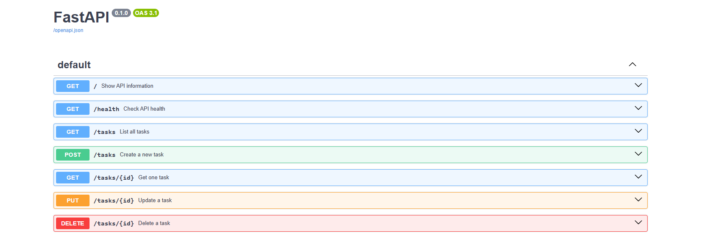

# Task API

A small REST API built with Python and FastAPI for managing a to-do list.

The project demonstrates the four basic CRUD operations:

- **Create** tasks
- **Read** tasks
- **Update** tasks
- **Delete** tasks

The API stores tasks in memory, so the data is reset whenever the server is restarted.

---

## Technologies Used

- Python 3
- FastAPI
- Uvicorn
- Pydantic
- Swagger UI
- Git & GitHub

---

## Getting Started

### 1. Install the Dependencies

After cloning the repository, install the required packages:

    pip install -r requirements.txt

### 2. Start the API

Run the following command:

    uvicorn main:app --reload

The server will start at:

    http://localhost:8000

### 3. Open the API

**Main API**

    http://localhost:8000

**Health Check**

    http://localhost:8000/health

**Interactive Swagger Documentation**

    http://localhost:8000/docs

---

## API Endpoints

| Method | Endpoint | Description |
|:---:|---|---|
| GET | `/` | Displays API information |
| GET | `/health` | Checks whether the API is running |
| GET | `/tasks` | Returns all tasks |
| GET | `/tasks/{id}` | Returns a single task |
| POST | `/tasks` | Creates a new task |
| PUT | `/tasks/{id}` | Updates an existing task |
| DELETE | `/tasks/{id}` | Deletes a task |

---

## Task Format

Each task contains three fields:

    {
      "id": 1,
      "title": "Learn FastAPI",
      "done": false
    }

- `id` — unique task number
- `title` — task description
- `done` — indicates whether the task has been completed

---

## CRUD Operations

### Create a Task

A new task can be created using `POST /tasks`.

Example request:

    curl -i -X POST http://localhost:8000/tasks -H "Content-Type: application/json" -d "{\"title\":\"Buy milk\"}"

Example response:

    HTTP/1.1 201 Created
    content-type: application/json

    {"id":4,"title":"Buy milk","done":false}

### Read Tasks

To retrieve all tasks:

    curl -i http://localhost:8000/tasks

To retrieve a specific task:

    curl -i http://localhost:8000/tasks/1

### Update a Task

For example, to mark task 1 as completed:

    curl -i -X PUT http://localhost:8000/tasks/1 -H "Content-Type: application/json" -d "{\"done\":true}"

The API returns the updated task with a `200 OK` response.

### Delete a Task

To delete task 1:

    curl -i -X DELETE http://localhost:8000/tasks/1

A successful deletion returns:

    HTTP/1.1 204 No Content

---

## Error Handling

The API returns appropriate HTTP status codes when requests succeed or fail.

| Status Code | Meaning | Example |
|:---:|---|---|
| `200` | Request successful | Reading or updating a task |
| `201` | Resource created | Creating a task |
| `204` | Successful deletion with no response body | Deleting a task |
| `400` | Invalid request | Empty update body |
| `404` | Task not found | Requesting `/tasks/99` |

---

## Swagger UI

FastAPI automatically generates interactive API documentation using Swagger UI.

Open:

    http://localhost:8000/docs

Swagger UI allows the API endpoints to be viewed and tested directly from the browser without using `curl`.

---

## Project Structure

    task-api/
    │
    ├── main.py
    ├── requirements.txt
    ├── README.md
    ├── swagger.png
    └── .gitignore

### Files

- `main.py` — FastAPI application and CRUD endpoints
- `requirements.txt` — Python dependencies
- `README.md` — project documentation
- `swagger.png` — Swagger UI screenshot
- `.gitignore` — files excluded from Git

---

## Notes

This project uses an **in-memory list** instead of a database. Therefore, tasks are lost when the server is stopped or restarted.

This was intentional for the assignment so that the focus remains on understanding API endpoints, HTTP methods, and CRUD operations.

---

## Author

Backend Track — Week 2 Assignment
